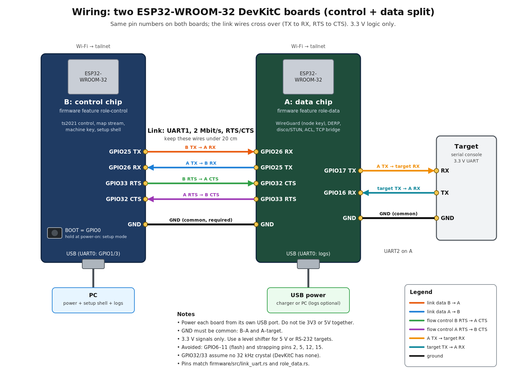

# usb-serial-over-tailscale for two ESP32-WROOM-32 boards

[日本語](README.ja.md)

This is a fork of [signal-slot/usb-serial-over-tailscale](https://github.com/signal-slot/usb-serial-over-tailscale) by Tasuku Suzuki.
The original turns one ESP32-S3 with PSRAM into a Tailscale node that bridges a target board's serial console to a TCP port on your tailnet.
The background is in his article: [ESP32-S3 単体を Tailscale ノードにして、SBC のシリアルコンソールをどこからでも開く](https://zenn.dev/tasuku/articles/0caef1a822c4e6) (Zenn, Japanese).

I had two old ESP32-WROOM-32 DevKitC boards lying around and wanted to use them for the same job.
They have no PSRAM, and a full Tailscale node (control client, WireGuard, DERP, TCP stack) does not fit in one of them with room to spare.
So this fork splits the node across the two chips: one talks to the control server, the other carries the packets and the serial console.
They talk to each other over a UART link.

## Status

Read this first.

- Both firmware roles build for `xtensa-esp32-espidf` (ESP-IDF v5.3.3, no PSRAM, 4 MB flash).
- The host-side tests pass, including an integration test that runs both roles in one process over a lossy socket pair.
- **It has not been run on real hardware yet.** The UART link at 2 Mbit/s, Wi-Fi on both chips and the memory headroom are all untested.
- The heap and stack numbers below are estimates from the build output and the disassembly, not measurements.

If you want something that works today, use the upstream ESP32-S3 version.

## How it is split

| | Chip B (control, `role-control`) | Chip A (data, `role-data`) |
| --- | --- | --- |
| Network | Wi-Fi, talks only to the control server | Wi-Fi, carries all tailnet traffic |
| Tailscale | ts2021 control client (Noise, HTTP/2), map stream, registration | WireGuard, disco/STUN, DERP, packet filter (ACL), smoltcp TCP stack |
| Keys | machine key | node key (the private half never leaves A) |
| Serial | setup shell and logs on UART0 (USB) | target console on UART2, logs on UART0 |

B receives the network map from the control server and turns it into a compact configuration for A: addresses, DERP map, peers and packet filter.
A applies it and reports back its public keys, endpoints, home DERP region and peer status.
When B is down, A keeps running on the last configuration it applied, so existing connections stay up.

The link between the chips (`crates/splitlink`):

- UART1 at 2 Mbit/s with RTS/CTS hardware flow control.
- Frames are COBS-encoded with a CRC-32. Every message is acknowledged and retransmitted if the ACK does not come back.
- Each side picks a random epoch at boot, so a reboot of either chip is noticed right away.
- Configuration is versioned. B sends a full snapshot when bulk state changes or when A reports a different version, and small deltas (peer added, removed or patched) otherwise.

More detail is in [docs/split-design.md](docs/split-design.md).

## Parts

- 2 x ESP32-WROOM-32 DevKitC (or a compatible board with a USB-UART chip). 4 MB flash, no PSRAM needed.
- 7 jumper wires for the link and ground, under 20 cm.
- 3 jumper wires to the target (TX, RX, GND).
- 2 USB cables and a USB power source for each board.
- The target must have a 3.3 V UART. For 5 V or RS-232 levels you need a level shifter.

## Wiring



Both boards use the same pin numbers. The link wires cross over.

| From | To | Signal |
| --- | --- | --- |
| B GPIO25 (TX) | A GPIO26 (RX) | link data B to A |
| A GPIO25 (TX) | B GPIO26 (RX) | link data A to B |
| B GPIO33 (RTS) | A GPIO32 (CTS) | flow control |
| A GPIO33 (RTS) | B GPIO32 (CTS) | flow control |
| B GND | A GND | common ground (required) |
| A GPIO17 (TX) | target RX | target console |
| A GPIO16 (RX) | target TX | target console |
| A GND | target GND | common ground (required) |

- Power each board from its own USB port. Do not connect 3V3 or 5V between the boards.
- B's USB port goes to your PC for the setup shell. The BOOT button (GPIO0) on B, held at power-on, enters setup mode.
- Pins I stayed away from: GPIO6 to 11 (connected to flash) and the strapping pins 2, 5, 12 and 15. GPIO32 and 33 are free on the DevKitC because it has no 32 kHz crystal.
- Keep the link wires short. If you need longer wires, lower `LINK_BAUD` in `firmware/src/link_uart.rs` on both boards.

The source is [docs/wiring.svg](docs/wiring.svg).

## Building

You need the `esp` Rust toolchain from `espup`, plus `ldproxy` and `espflash`.
ESP-IDF itself is downloaded into `firmware/.embuild/` on the first build. That takes a while and a few GB of disk.

```bash
cargo install espup ldproxy espflash
espup install
```

Do not source `~/export-esp.sh`. The build uses the gcc that esp-idf-sys installs into `.embuild/`, and having espup's Xtensa gcc first on `PATH` breaks the link.

Build each role into its own target directory so one does not overwrite the other:

```bash
cd firmware
CARGO_TARGET_DIR=target-control cargo build --release --features role-control
CARGO_TARGET_DIR=target-data    cargo build --release --features role-data
```

Image sizes from my build: about 1.44 MB for B and 1.33 MB for A.

Host tests, from the repository root:

```bash
cargo test --workspace
cargo test -p tsnode --features split          # both roles over a lossy socket pair
cargo test -p tsnode --features lowmem,split
```

## Flashing

The WROOM-32 has 4 MB of flash. Use `partitions-wroom32.csv`, not `partitions.csv` (that one has a 6 MB app slot for the bigger S3 modules).
The DevKitC's USB-UART usually shows up as `/dev/ttyUSB0` on Linux; adjust the port for your machine.

```bash
cd firmware
# chip B
espflash flash --chip esp32 --port /dev/ttyUSB0 --flash-size 4mb \
  --partition-table partitions-wroom32.csv \
  target-control/xtensa-esp32-espidf/release/usb-serial-over-tailscale-firmware
# chip A (plug it in instead, or use its own port)
espflash flash --chip esp32 --port /dev/ttyUSB0 --flash-size 4mb \
  --partition-table partitions-wroom32.csv \
  target-data/xtensa-esp32-espidf/release/usb-serial-over-tailscale-firmware
```

`cargo run` uses the runner in `firmware/.cargo/config.toml`, which is still set up for the S3 board (16 MB flash, `/dev/ttyACM0`). Use the commands above instead.

## Setup

1. Flash both boards and wire them as above.
2. Open B's serial port at 115200 baud (`screen /dev/ttyUSB0 115200`) and press Enter. The setup wizard is the same as upstream: Wi-Fi network, hostname, then a Tailscale approval URL (or `authkey tskey-auth-...` followed by `login`).
3. B forwards the Wi-Fi networks, TCP port and baud rate to A. A stores them and restarts once to start the bridge.
4. B registers with the node public key that A reported, then keeps A's configuration up to date.
5. From another machine on the tailnet, connect to the console with any raw TCP client. The upstream article uses socat:

   ```bash
   socat -,rawer,escape=0x1d TCP:target-console:35930   # Ctrl-] to quit
   ```

`status` on B shows the Tailscale state and whether the data chip is reachable and in sync. `port <n>` and `baud <rate>` change the TCP port (default 35930) and the target baud rate (default 115200).

## Memory estimates

These are estimates, not measurements.

| | B (control) | A (data) |
| --- | --- | --- |
| Static DRAM (.data + .bss) | 31.5 KB | 31.5 KB |
| Heap after Wi-Fi start (assumed) | 180 to 220 KB | 180 to 220 KB |
| Steady use, stacks + heap | about 95 KB | about 130 KB |
| Peak use | 150 to 170 KB (map decode) | about 170 KB (DERP TLS handshake + snapshot) |

A is the tight one. Measuring this on hardware is the first thing to do.

## Limitations

- Not verified on hardware (see Status).
- At most 32 peers and 2 concurrent DERP connections. These limits come from the `lowmem` build used to fit in internal RAM.
- IPv6 is disabled in lwIP to save memory. Tailnet IPv6 addresses are configured, but the boards only reach the internet over IPv4.
- One serial port (UART2), not one per USB interface like the upstream S3 version.
- Wi-Fi passwords are sent in plain text over the link between the chips. It is a short wire between two boards you own, but keep it in mind.
- A keeps its configuration in RAM only. If A reboots while B is down, A has no peers until B comes back.
- Peer status shown on B is refreshed every 2 seconds.
- No reset wiring or watchdog between the two chips yet.
- The browser flasher and CI in `web/` and `.github/` are from upstream and are for the S3 version.

## Roadmap

Phase 2 is hardware bring-up:

1. Check the UART link with RTS/CTS at 2 Mbit/s on real wires and tune the ACK timeout.
2. Measure free heap, the largest free block and each thread's stack high-water mark, and replace the estimates above.
3. Test end to end on a real tailnet: registration, DERP and direct paths, the console bridge, and stopping B while a session is open.
4. Save A's last configuration to NVS so it survives a reboot while B is down.
5. Cross-wire EN pins or add a watchdog between the chips.

## Branches

- `esp32-split` (default): the two-chip version described here.
- `esp32-nopsram`: an attempt to fit everything on one WROOM-32. It builds, but by my estimates its peak memory use does not fit.
- `esp32-uart-probe`: the first experiment, a single ESP32 (M5StickC Plus2) with a UART instead of USB host.
- `main`: upstream, unchanged.

## Credit and license

The original design and almost all of the Tailscale implementation (control client, WireGuard, DERP, disco, netstack) are by Tasuku Suzuki in [signal-slot/usb-serial-over-tailscale](https://github.com/signal-slot/usb-serial-over-tailscale). See also his [Zenn article](https://zenn.dev/tasuku/articles/0caef1a822c4e6).
This fork adds the WROOM-32 port, the control/data split and the link protocol.

The upstream README is kept in [docs/UPSTREAM_README.md](docs/UPSTREAM_README.md) ([日本語](docs/UPSTREAM_README-ja.md)).

MIT License, same as upstream. See [LICENSE](LICENSE) (Copyright (c) 2026 Tasuku Suzuki).
